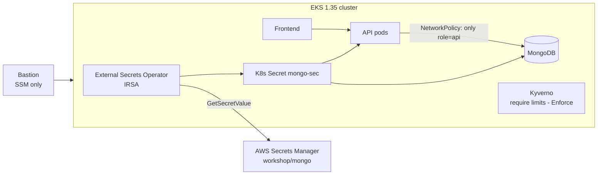
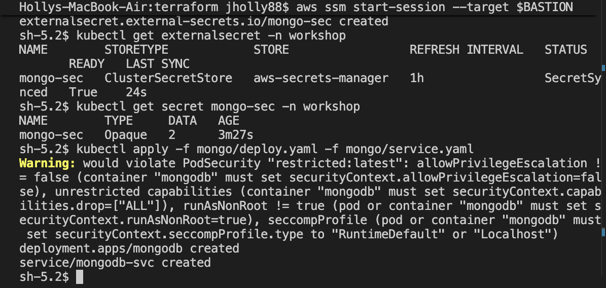
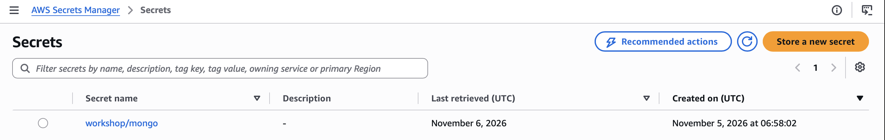
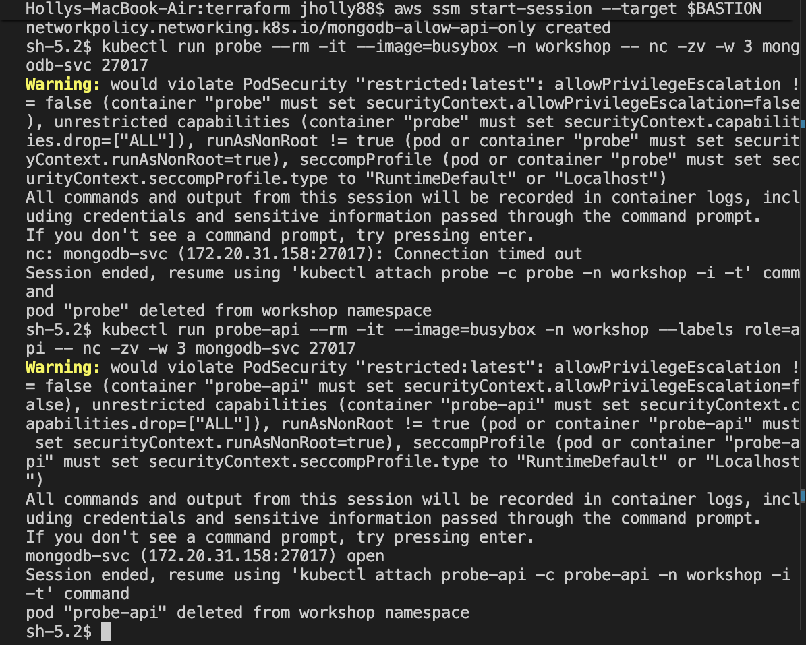
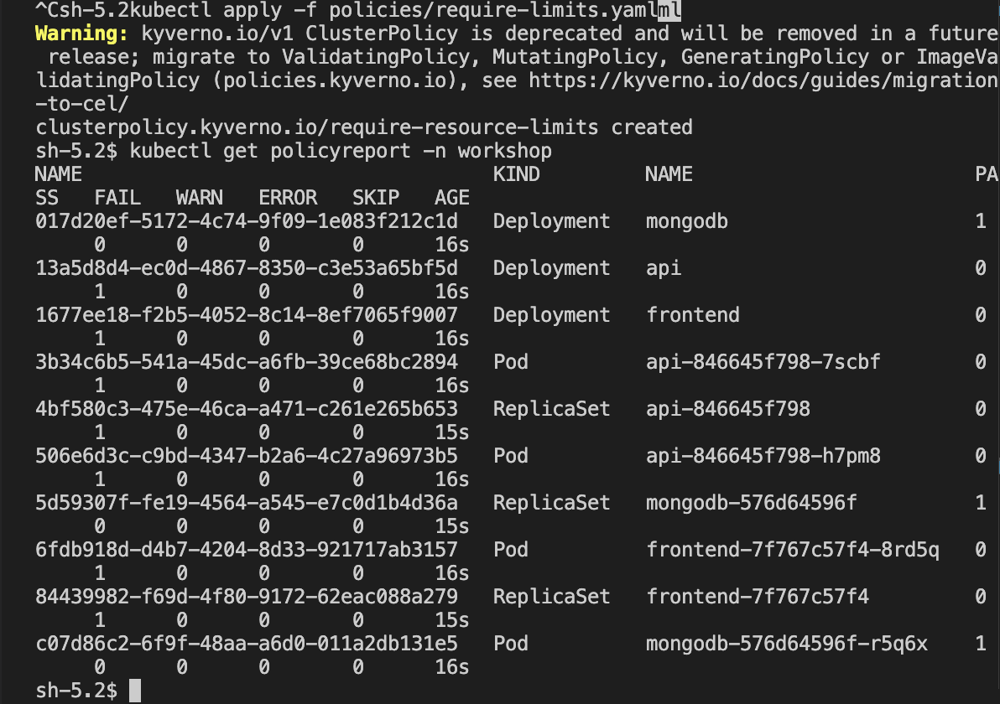
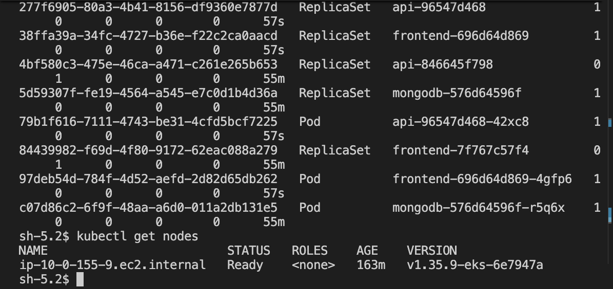
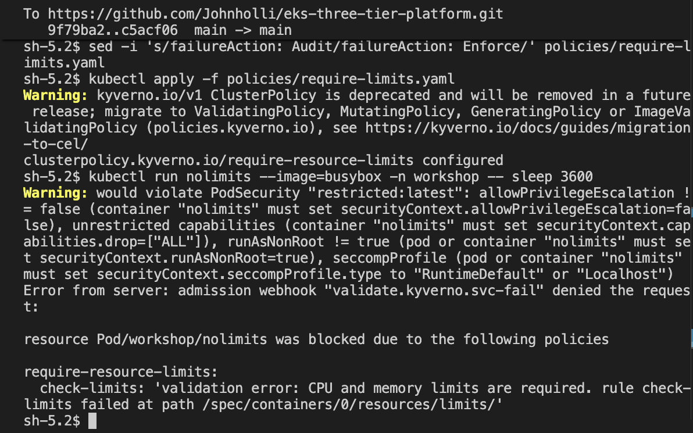
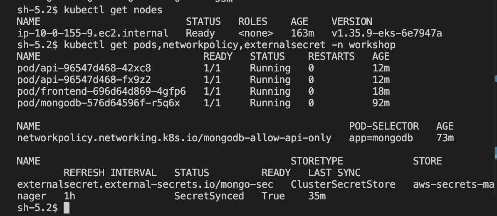

# EKS Three-Tier Platform — Security Hardened

[](https://www.terraform.io/)
[](https://aws.amazon.com/eks/)
[](https://kubernetes.io/)
[](https://kyverno.io/)

Terraform provisions an Amazon EKS cluster (VPC with public/private subnets, NAT, flow logs, SSM-only bastion, IRSA roles) running a three-tier app (frontend, API, MongoDB). On top of the base platform I hardened the cluster: secrets moved out of Git into AWS Secrets Manager, Pod Security Admission, a database network policy, and Kyverno policy-as-code taken from audit to enforce.

## Architecture



## Security Hardening

### 1. Secrets out of Git — AWS Secrets Manager + External Secrets Operator
- **Problem:** the Mongo credentials were committed in `k8s_manifests/mongo/secrets.yaml` (base64 is encoding, not encryption).
- **Fix:** Terraform generates a random password (`terraform/secrets.tf`) and stores it in AWS Secrets Manager. External Secrets Operator syncs it into the cluster as the same `mongo-sec` secret, authenticating with an IRSA role scoped to that one secret ARN (`terraform/external_secrets_irsa.tf`). No deployment changes were needed.
- **Why it was replaced, not just deleted:** deleting a file doesn't remove it from Git history, so the old credential was treated as compromised and replaced with a newly generated one.





### 2. Pod Security Admission
The `workshop` namespace (`k8s_manifests/namespace.yaml`) **enforces `baseline`** (blocks privileged and host-access pods) and **warns on `restricted`**. The yellow `Warning: would violate PodSecurity "restricted:latest"` lines in the screenshots show the remaining gap to the strictest level (non-root, drop all capabilities, seccomp profile) — see Next Steps.

### 3. Network policy — only the API can reach MongoDB
`k8s_manifests/mongo/network-policy.yaml` allows ingress to MongoDB on 27017 only from pods labeled `role=api`. Enforcement is enabled in the VPC CNI add-on (`enableNetworkPolicy` in `terraform/eks.tf`).

Test: a pod without the label **times out**; a pod with `role=api` connects.



### 4. Kyverno policy-as-code — audit → fix → enforce
`k8s_manifests/policies/require-limits.yaml` requires CPU and memory limits on every pod in `workshop`.

1. **Audit:** the policy report flagged the API and frontend (no limits); MongoDB passed.
2. **Fix:** added requests/limits to both deployments.
3. **Enforce:** switched `failureAction` to `Enforce` — pods without limits are now rejected at admission.

| Before | After |
|---|---|
|  |  |



### 5. Platform baseline
- EKS API endpoint restricted to the bastion's IP; bastion reachable **only through SSM Session Manager** (no SSH, no inbound ports), IMDSv2 required, encrypted root volume.
- IRSA (IAM Roles for Service Accounts) for the VPC CNI, load balancer controller, cluster autoscaler, and External Secrets — no node-wide credentials.
- Upgraded from Kubernetes 1.29 (retired by EKS) to **1.35**.



## Repo Layout
- `terraform/` — VPC, EKS, bastion, IRSA roles, Secrets Manager secret
- `terraform/three-tier-eks-iac/app/` — frontend and backend source
- `terraform/three-tier-eks-iac/k8s_manifests/` — namespace, app, network policy, External Secrets, Kyverno policy

## Deploy

**1. Provision infrastructure (your machine)**
```bash
cd terraform
terraform init
terraform apply
terraform output -raw external_secrets_role_arn   # copy for step 3
```

**2. Connect to the bastion (your machine)**
```bash
BASTION=$(aws ec2 describe-instances --filters "Name=tag:Name,Values=my-eks-cluster-bastion" "Name=instance-state-name,Values=running" --query "Reservations[].Instances[].InstanceId" --output text)
aws ssm start-session --target $BASTION
```

**3. Install operators and deploy (on the bastion)**
```bash
aws eks update-kubeconfig --region us-east-1 --name my-eks-cluster

helm repo add external-secrets https://charts.external-secrets.io
helm install external-secrets external-secrets/external-secrets -n external-secrets --create-namespace \
  --set serviceAccount.annotations."eks\.amazonaws\.com/role-arn"=<ROLE_ARN>

cd terraform/three-tier-eks-iac/k8s_manifests
kubectl apply -f namespace.yaml
kubectl apply -f external-secrets/cluster-secret-store.yaml -f mongo/external-secret.yaml
kubectl apply -f mongo/deploy.yaml -f mongo/service.yaml
kubectl apply -f backend-deployment.yaml -f backend-service.yaml
kubectl apply -f frontend-deployment.yaml -f frontend-service.yaml
kubectl apply -f mongo/network-policy.yaml

helm repo add kyverno https://kyverno.github.io/kyverno/
helm install kyverno kyverno/kyverno -n kyverno --create-namespace
kubectl apply -f policies/require-limits.yaml
```

**4. Verify**
```bash
kubectl get externalsecret -n workshop          # SecretSynced
kubectl get pods -n workshop                    # all Running
kubectl get policyreport -n workshop            # PASS
kubectl run probe --rm -it --image=busybox -n workshop -- nc -zv -w 3 mongodb-svc 27017   # blocked
```

## Teardown
```bash
# on the bastion
kubectl delete namespace workshop
exit

# on your machine
cd terraform
terraform destroy
```

## Issues I Hit and How I Solved Them
- **Kubernetes 1.29 retired.** EKS no longer creates 1.29 clusters, and versions in extended support cost $0.60/hr vs. $0.10/hr. Upgraded to 1.35 (standard support).
- **Node group stuck in CREATING for 30+ minutes.** EKS showed no health issues, so I checked the Auto Scaling activity history: the new account was on the AWS free plan, which rejects `t3.medium`. Listed free-plan-eligible types with `aws ec2 describe-instance-types --filters Name=free-tier-eligible,Values=true` and moved to a single `m7i-flex.large` node.
- **Policy report not updating after the fix.** Kyverno's background scan runs on an interval; restarting `kyverno-reports-controller` forced a rescan.
- **Committed credential.** Removing the file wasn't enough because Git keeps history — rotated to a Terraform-generated password in Secrets Manager.

## Cost
Roughly $0.25–0.30/hour while running (EKS control plane, one node, NAT gateway, bastion). I destroy the stack after every session.

## Next Steps
- Enforce Pod Security **restricted**: run MongoDB as non-root, drop all capabilities, set seccomp `RuntimeDefault`.
- Add Falco for runtime threat detection.
- Expose the app through the ALB with TLS (ACM certificate) and a custom domain.
- Move Terraform state to an encrypted S3 backend with locking, and add Checkov/tfsec scanning in CI.

## Acknowledgements
The application code and base Kubernetes manifests are adapted from a public EKS three-tier workshop. The security hardening described above is my own addition.
